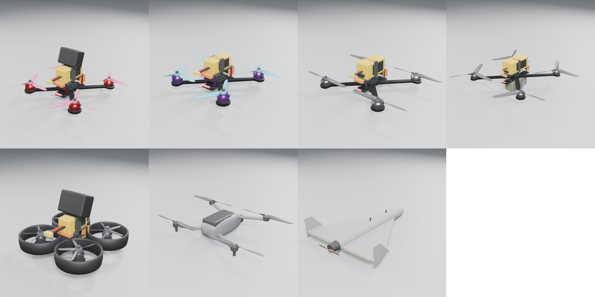
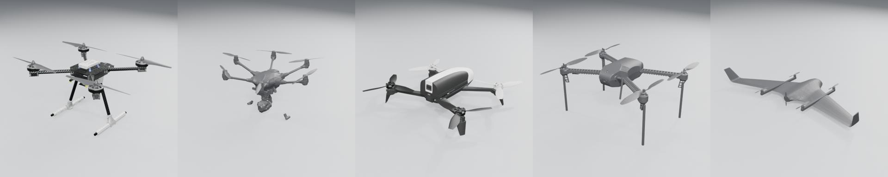
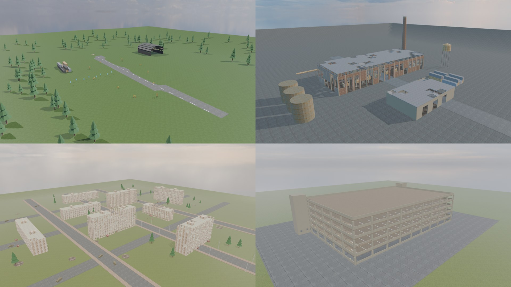

# DroneSim

Реалистичный симулятор управления дронами для обучения и практики — FPV (5"/7"/10", синевуп), камерные GPS-дроны (класс Mavic, Bebop, Typhoon), платформы PX4/ArduPilot, VTOL и самолётного типа. ПК + Android/iOS, управление с клавиатуры, тача, геймпада и настоящего RC-пульта.

**Статус:** готова демо-версия — 15 дронов (FPV, камерные GPS, PX4/ArduPilot, VTOL, крылья), 4 карты с окрестностями (лес, город, промзона, горы), Академия из 12 уроков, гонка с призраком, новый HUD. Дорожная карта — [`docs/PLAN.md`](docs/PLAN.md).

## Быстрый старт (без установки)
Всё лежит в [последнем релизе](../../releases/latest):

| Что | Как запустить |
|---|---|
| **Онлайн** | https://cubestalkertube-creator.github.io/DroneSim/ — открыть в Chrome / Edge (первая загрузка ~0.5 ГБ) |
| **ПК (Windows), офлайн** — `DroneSim-PC.zip` | распаковать → двойной клик по **`Запустить DroneSim.bat`** → браузер откроется сам (окно с сервером не закрывать). Ничего ставить не нужно, работает без интернета. Все 4 карты, 2k-текстуры |
| **Android** — `DroneSim.apk` | скачать на телефон → установить (разрешить «установку из неизвестных источников»). 2 карты (Полигон, Паркинг), облегчённые текстуры |

Если `.bat` заблокирован на компьютере — открыть онлайн-версию, или из распакованной папки: `npx serve .` (нужен Node.js). Двойной клик по `index.html` не сработает (браузер не даёт модулям и WASM грузиться с `file://`).

## Запуск из исходников
```bash
git clone https://github.com/cubestalkertube-creator/DroneSim.git
cd DroneSim/app
npm install
npm run dev
```
Открыть http://localhost:5173. При первом запуске `npm run dev` сам скачает облегчённые ассеты (~58 МБ, 1k-текстуры) из Releases в `assets/`. Полный набор (3.8 ГБ) в репозитории не хранится — он пересобирается скриптами из `tools/`, см. [`docs/ASSETS.md`](docs/ASSETS.md).

Управление: `W/S` газ, `A/D` рыскание, стрелки — тангаж/крен, `Пробел` арм, `1/2/3` режимы, `C` камера, `R` рестарт, `M` мышь как стик. Геймпад и RC-пульт (USB Joystick) подхватываются автоматически.

## Документы
| Файл | О чём |
|---|---|
| [`docs/PLAN.md`](docs/PLAN.md) | мастер-план: стек, архитектура, управление, режимы, UI, звук, графика, **этапы с чек-листами** |
| [`docs/research/PHYSICS.md`](docs/research/PHYSICS.md) | физическая модель: моторы, батарея, пропеллеры, пропвош, ветер, полётные контроллеры, тесты |
| [`docs/research/DRONES.md`](docs/research/DRONES.md) | каталог 12 дронов: как каждый летает и управляется |
| [`docs/ASSETS.md`](docs/ASSETS.md) | ассеты, источники, лицензии, пересборка |
| [`docs/design/DESIGN.md`](docs/design/DESIGN.md) | дизайн-система; [`ui_mockup.html`](docs/design/ui_mockup.html) — интерактивный макет |
| [`CLAUDE.md`](CLAUDE.md) | правила для ИИ-сессий |

## Превью




## Структура
```
assets/   models/drones (GLB) · maps (GLB+JSON) · textures (PBR 2K) · hdri · props · audio · presets/drones.json · manifest.json
docs/     PLAN, research, design, previews
tools/    fetch_* (Poly Haven, Freesound, Sketchfab), build_manifest, prune_audio, blender/ (drone_builder, map_builder, sdf_to_glb, render_*), портативный Blender 4.5
app/      игра: src/sim (физика 1 кГц, Betaflight FC), render, input, camera, game, ui; test/ (vitest)
```
