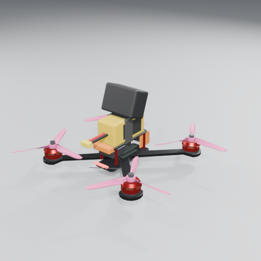
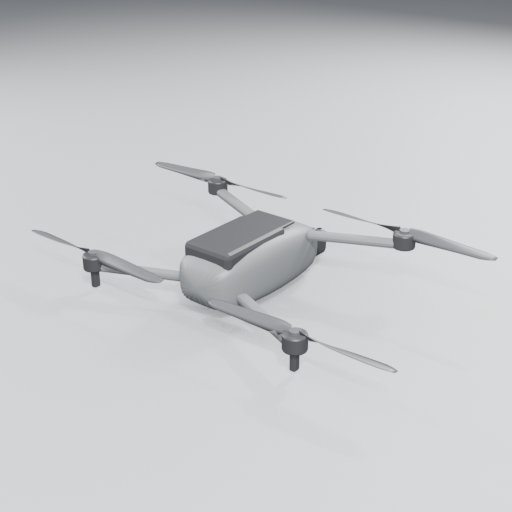
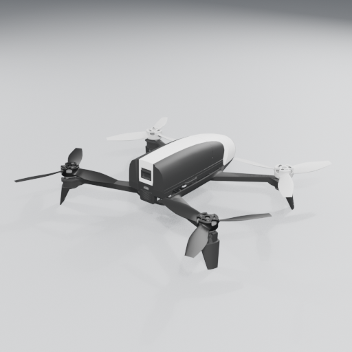
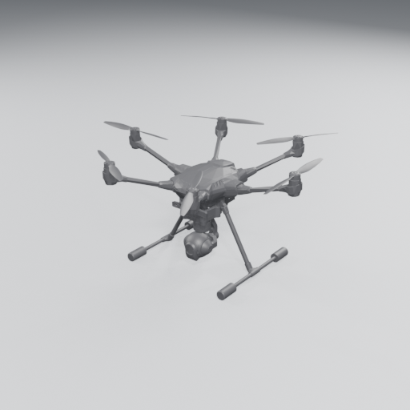
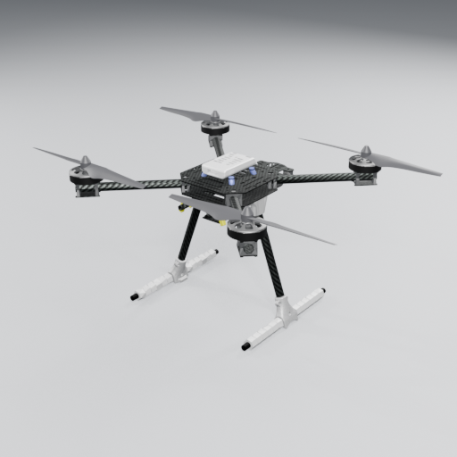
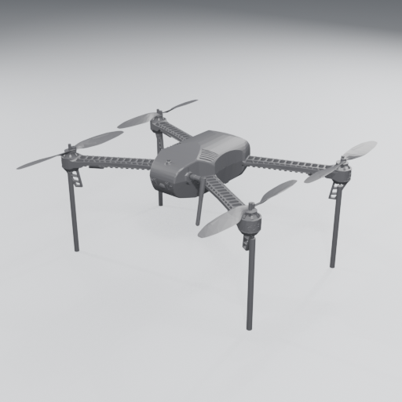
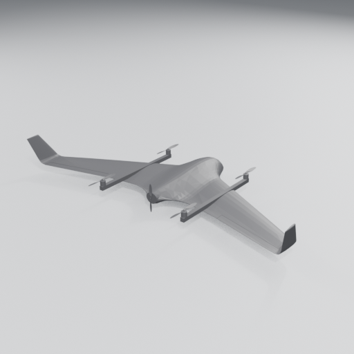
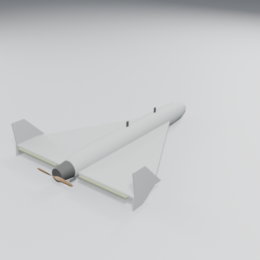

# Каталог дронов DroneSim

Числовые параметры — в [`assets/presets/drones.json`](../../assets/presets/drones.json) (единый источник правды для кода). Модели — `assets/models/drones/*.glb`, превью — `docs/previews/`. Здесь — **как каждый летает и чем отличается управление**, чтобы механики делались не «одинаковыми с разной скоростью».

Классы управления (`fc.type`):
* **betaflight** — FPV: Acro по умолчанию, rates/PID как в Betaflight, airmode, turtle. Газ — НЕ самоцентрирующийся стик.
* **gps_consumer** — DJI-подобные: стики = скорости, отпустил — висит на месте (GPS+vision), лимиты наклона/скоростей по режимам C/N/S, RTH, ATTI при потере GPS. Газ — самоцентрирующийся (центр = удержание высоты).
* **px4 / ardupilot** — dev-платформы: Position/Loiter, AltHold, Stabilized, Acro, Mission (полёт по точкам из планировщика), RTL.
* **px4_vtol** — мультикоптерный взлёт → переход в самолёт → посадка вертикально (`sim/fc/vtol.ts`).
* **fixed_wing_fbw** — самолёт: стики = крен/угол траектории, автомат тяги, без висения (`sim/fc/plane.ts`, аэродинамика — `sim/wing.ts`).

---

## FPV

### 1. FPV 5" Freestyle — `fpv_5in_freestyle` (своя модель)

* Реальный аналог: типичный фристайл-сетап 2023–2026 (рама 225 мм true-X, 2306 1750KV, 5.1×3.6×3, 6S 1100–1300, DJI O3/Walksnail, GoPro сверху). AUW ≈ 620 г, TWR ≈ 10:1, 130–150 км/ч, 2.5–5 мин.
* **Характер**: резкий, «прилипает» к стикам, мгновенный панч. Камера с уптилтом 30° → на висении видно землю, в полёте вперёд — горизонт. GoPro добавляет инерцию и лобовое сопротивление (опционально снять в ангаре → −60 г, +5 % отзывчивости).
* Обучаемые фишки: power loop, split-S, dive, matty flip, juicy flick, rubik, гаппинг, proximity в бандо. Пропвош на снижениях — главный «враг» (см. PHYSICS §3.4).

### 2. FPV 5" Racer — `fpv_5in_racer`
* Лёгкий (480 г), без экшн-камеры, уптилт 45°, агрессивный проп 5.1×4.3. TWR ≈ 13, до 170–180 км/ч, 2–3 мин. Аналог видео (низкая задержка, но шум и срывы сигнала).
* Режим игры: гонки по воротам, MultiGP-подобные трассы, time trial, призрак лучшего круга.

### 3. FPV 7" Long Range — `fpv_7in_longrange`
* 950 г, Li-ion 6S 4000 мА·ч, GPS, ELRS 900 МГц, 2-лопастные 7". Плавнее, больше инерция, спокойный крейсер 50–70 км/ч, 15–22 мин.
* Механики: управление запасом батареи (напряжение Li-ion проседает сильно!), дальность связи и видео (RF-модель с затенением рельефом/зданиями), GPS Rescue при потере сигнала, ветер на высоте.

### 4. FPV 10" Heavy Lift — `fpv_10in_heavy`
* 2.2 кг + до 1.5 кг груза (коробка снизу), 3115 900KV, 10×5×3, Li-ion 8000 мА·ч. Медленный разгон моторов (τ ≈ 0.1 с), заметный гироскопический эффект, сильный пропвош.
* Механики: доставка груза (смена массы/инерции/ЦТ, раскачка), сброс груза в зону (гражданская доставка/спасательный пакет), полёт в ветер. По умолчанию — Angle.

### 5. Cinewhoop 3" (с защитой винтов) — `cinewhoop_3in`
* 380 г, 5-лопастные 3" в кольцах (+12 % тяги от кольца, но большое сопротивление). Медленный и устойчивый к касаниям (пропы защищены — удар не ломает пропеллер).
* Механики: съёмка «пролётов» в помещениях, плавность, полёт сквозь узкие проёмы; кинематографические челленджи (оценка плавности по jerk).

---

## Камерные / GPS

### 6. Складной камерный дрон (класс Mavic 3) — `camera_drone_fold`

* 900 г, 4×9.4", умная батарея 5000 мА·ч, 40–46 мин, 3-осевой подвес, препятствия спереди/сзади/снизу.
* **Управление**: режимы Cine (5 м/с, 15°) / Normal (15 м/с, 25°) / Sport (21 м/с, 35°). Отпустил стики — тормозит и висит. Колесо наклона камеры (тач-слайдер / колесо мыши / ползунок пульта). RTH: набор высоты → полёт домой → посадка. **ATTI** (потеря GPS в бандо/под мостом/между домами): дрон перестаёт держать позицию и дрейфует по ветру — отдельный учебный урок.
* Механики: съёмка (фото/видео, QuickShots: орбита, «дрон-ни», спираль), маршрут по точкам, геозоны и лимит высоты 120 м, предупреждение о ветре.

### 7. Parrot Bebop 2 — `parrot_bebop_2` (Gazebo, CC0)

* 503 г, Wi-Fi управление со смартфона (ограниченная дальность ~300 м, большая задержка). Цифровая стабилизация «рыбьего глаза». Идеален как **«дрон для смартфона»** в мобильной версии (управление с телефона естественно).

### 8. Yuneec Typhoon H480 — `typhoon_h480` (Gazebo, CC-BY 4.0)

* Гексакоптер 2 кг, складывающиеся шасси (автоуборка после взлёта — анимация ног), камера 360° на подвесе. **Отказоустойчивость**: при отказе одного мотора продолжает полёт (учебный сценарий «отказ мотора»).

---

## Dev-платформы (обучение автопилотам)

### 9. Holybro X500 V2 (PX4) — `x500` (Gazebo, CC-BY 4.0)

* 2 кг, 13" пропеллеры, параметры моторов взяты из официальной модели PX4 (`motorConstant 8.55e-6`, `timeConstantUp 12.5 мс`). Режимы PX4: Position/Altitude/Stabilized/Acro/Mission/RTL.
* Механики: планировщик миссий на карте (как QGroundControl), фейлсейфы, «оператор БВС» — обучение процедурам (предполётная проверка, калибровка компаса, арминг).

### 10. 3DR Iris+ (ArduPilot) — `iris_with_standoffs` (Gazebo, CC0)

* 1.5 кг, режимы ArduPilot: Stabilize (ручной газ!), AltHold, Loiter, RTL, Auto, Land. Хорош для обучения «без GPS-костылей» в Stabilize.

---

## Самолётного типа

### 11. VTOL летающее крыло (X8 + quad) — `standard_vtol` (Gazebo, CC-BY 4.0)

* 5 кг, размах 2.12 м, 4 подъёмных мотора + толкающий винт. Аэродинамические коэффициенты из PX4 LiftDrag (`CLa 4.75`, `alpha_stall 19.4°`, после срыва `CLa_stall −3.85`).
* **Управление** (`sim/fc/vtol.ts`, как PX4 VTOL): `1` MC Position (стики = скорости, газ в центре = висение) · `2` FW Position (переход в самолёт) · `3` Mission (маршрут `fc.route` от дома → RTL) · `4`/`H` RTL. Газ — самоцентрирующийся во всех фазах (в самолёте: центр = крейсерские 18 м/с, вверх — до 25 м/с, вниз — до 1.25·V_stall).
* **Переход вперёд**: подъёмные моторы держат высоту и горизонт, толкающий — на полном газу; при 15 м/с (`transition_airspeed`) FBW-контроллер берёт управление, подъёмные моторы плавно гаснут за 2 с. Нет скорости за 15 с — переход прерывается. **Обратный**: толкающий выкл., торможение сначала сопротивлением (носом не задирать — крыло «вспухнет»), затем наклоном коптера; висение. Скорость в FW ниже 0.85·V_stall — автоматический «quad-chute».
* Механики: вертикальный взлёт → переход → маршрут → обратный переход → вертикальная посадка. Ошибки перехода (срыв, недобор скорости) — реалистичны.
* **Калибровка (Этап 3)**: из Gazebo оставлены масса, инерция, `kT0` подъёмных, аэродинамика. Изменено: `kQ0` подъёмных 1.2e-6 → **3.2e-7** (momentConstant 0.06 м из SDF давал 2.3 кВт на висении и обвал батареи; реальные пропы 0.012–0.016 м); толкающий — 10" (`kT0 2.4e-5, kQ0 4.5e-7, J0 0.9, 1300 рад/с`, у Gazebo 105 Н статики и 3500 рад/с — ~200 км/ч); `r_cell` 8 мОм (6S2P); фюзеляж `cdA_z` 0.01. Итог: висение ~0.6 команды и ~37 А, крейсер 18 м/с ≈ 14 А (~45 мин на 10 А·ч — референс 60–90 мин не достигнут: avionics 3 А + КПД винта), максимум 90 км/ч.

### 12. Дельта-крыло класса Shahed-136 — `delta_wing_lm` (своя модель планера)

* Публичные габариты: длина ~3.5 м, размах ~2.5 м, масса ~200 кг, толкающий двухлопастный винт с двухтактным ДВС ~50 л.с., крейсер ~170–185 км/ч. Срыв ~110 км/ч (`C_Lmax 1.0`, S = 3.3 м² → 31 м/с).
* **Только полётная динамика**: старт с направляющей с ускорителем, крейсерский полёт по точкам, снос ветром, разворот с креном, посадка на парашюте или на брюхо. Никаких механик поражения целей в проекте нет — это учебный пилотаж/навигация.
* **Управление** (`sim/fc/plane.ts`, FBW): `1` **FBW-A** — стик = крен (до 40°) и угол траектории (центр = горизонтальный полёт на любой скорости), газ = заданная скорость (автомат тяги), газ в ноль = малый газ (планирование); `2` **Cruise** — держит высоту и путевой угол (с поправкой на снос), стики меняют курс/вертикальную; `3` **Waypoints** — маршрут `fc.route` (L1-наведение, патруль по кругу); `H` — RTL (домой, вираж над точкой старта); `G` — парашют. Защита от сваливания: ниже 1.15·V_stall нос опускается, крен ограничивается (у земли < 8 м пилот может выровнять/подорвать через неё).
* **Старт**: арм (газ в ноль) — двигатель на малом газу на направляющей 6 м / 15°; газ до упора — пуск ускорителя (4000 Н × 2 с), сход с направляющей ~0.8 с на ~16 м/с, к концу работы ~37 м/с, автонабор до 40 м под 4°.
* **Посадка**: парашют (`G`) — двигатель стоп, торможение до 1.15·V_stall, купол раскрывается за 2.5 с (площадь растёт ~квадратично — рифление), снижение ~6 м/с со сносом ветром, после касания стропы отцепляются; на брюхо — FBW-A, газ в ноль, у земли подорвать ручку, скольжение до остановки → автодизарм.
* **Калибровка (Этап 3)**: ДВС 37 кВт (момент ≈ throttle·P/Ω_max, ограничитель оборотов 760 рад/с, τ газа 0.4 с, расход 18 л/ч на полной мощности); винт 0.76 м `kT0 1.44e-3, kQ0 1.04e-4, J0 0.98` (было 3e-4/1.2e-5: при 37 кВт винт раскручивался бы до 1450 рад/с, а при шаге 14" тяга пропадала на 47 м/с) → статика ~670 Н, **185 км/ч** на полном газу, крейсер 165–170 км/ч на ~60 % мощности; ускоритель 9000 → **4000 Н** (9000 Н × 2 с давали ~80 м/с — выше максимальной); `cdA` [0.6, 0.3, 0.02] — только фюзеляж (крыло, включая обтекание плашмя `CD90`, — в `aero`); `J_arm` 3500 (посадка на парашюте 6 м/с — не авария).

## Ударные (камикадзе)

Подрыв заряда — только визуально-звуковой эффект и конец полёта (без целей и урона). Параметры заряда — блок `warhead` пресета: `mass` (входит в общую `mass`), `fuse_speed_ms` и `fuse_impulse_ns` (контактный взрыватель: удар о любую поверхность быстрее порога во взведённом состоянии), `blast_radius_m` (размер огненного шара). Подрыв вручную — `E` / RB / тумблер «Подрыв заряда» / тач-кнопка ✸, только в арме.

### 13. FPV 7" камикадзе — `fpv_7in_kamikaze` (модель `fpv_7in_longrange` + заряд)
Рама и моторы 7" Long Range, 6S Li-ion 4000 мА·ч, заряд 0.6 кг под рамой → 1.55 кг, TWR ≈ 3, висение ~45 % газа, 7–14 мин. Инерция и лобовое сопротивление выше на массу/габарит заряда. Аналоговое видео, взрыватель от 6 м/с.

### 14. FPV 10" камикадзе — `fpv_10in_kamikaze` (модель `fpv_10in_heavy` + заряд)
10" 3115 900KV, 6S 8000 мА·ч, заряд 1.4 кг → 3.6 кг, TWR ≈ 2.4, висение ~50 %. Инерционный, тормозит долго. Взрыватель от 6 м/с.

### 15. Шахед-136 (ударный) — `shahed_136_strike` (модель `delta_wing_lm`)
Тот же планер, что у учебного дельта-крыла (старт с направляющей, 37 кВт, FBW-A / Cruise / Waypoints), но бак 40 л, без парашюта, пикирование в FBW-A до 45° и до 30 м/с снижения. Заряд 50 кг (входит в 200 кг), взрыватель от 15 м/с.

## Что ещё добавить (этап 4+)
* Модели со Sketchfab (после `tools/fetch_sketchfab.py`): DJI FPV, Avata 2, Inspire 3, Bayraktar TB2, ZALA 421, Orion-E, «Морок», METIS — у каждого свой пресет в `drones.json` (скопировать ближайший класс и подправить массу/скорости по паспорту).
* Свой конструктор FPV («ангар»): выбор рамы/моторов/пропов/батареи → автоматический пересчёт массы, инерции, `kT0/kQ0`, TWR, времени полёта (`tools/blender/drone_builder.py` уже параметрический — можно генерировать модель в рантайме из тех же параметров на three.js).
